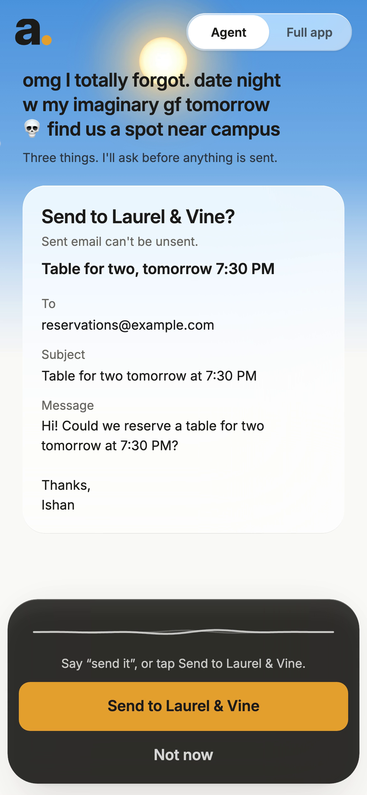
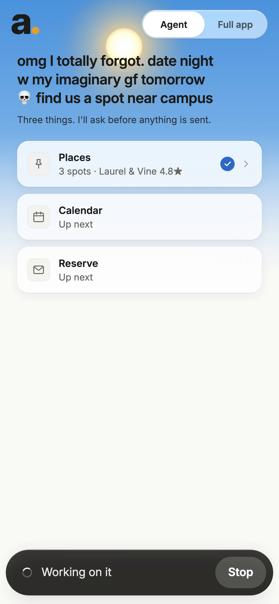
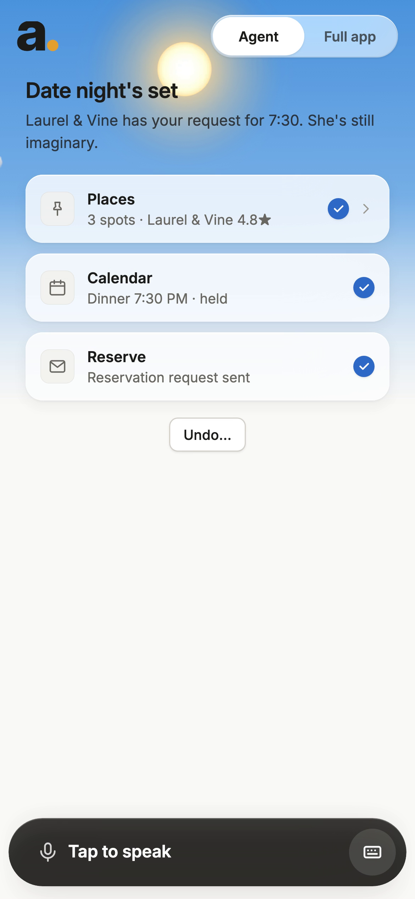
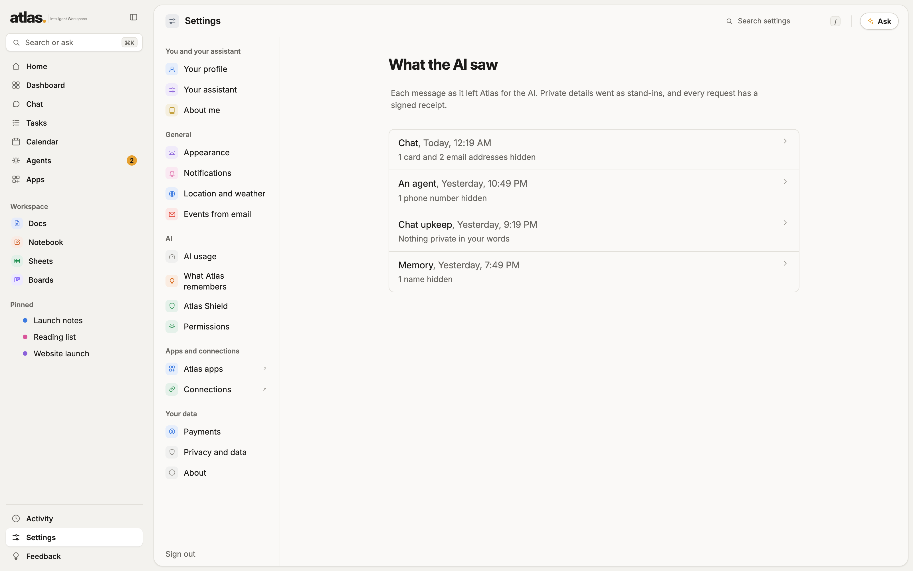
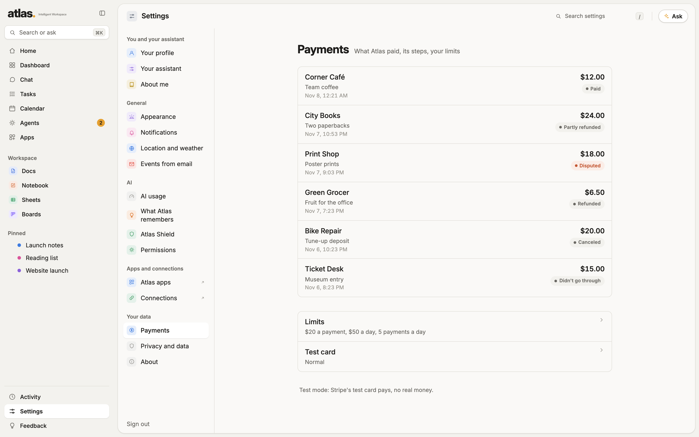
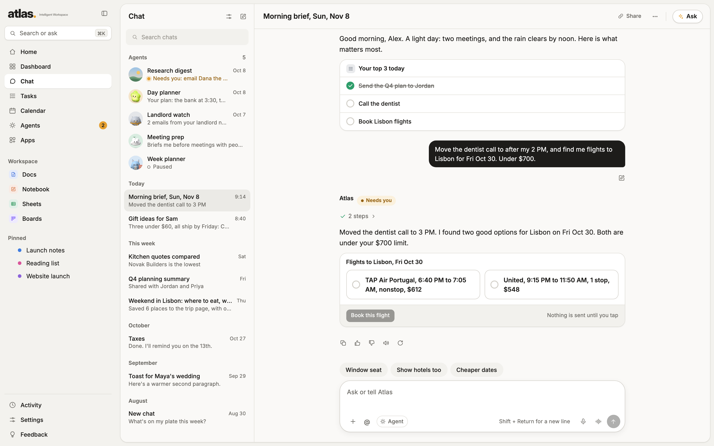

# Atlas: HACK1984 judges' demo repository

This repository is **for judges to read**. It holds the code written during HACK1984 (Sat 2026-11-07 11:00 AM ET to Sun 2026-11-08 11:00 AM ET), a patch of the full weekend diff, and screenshots. It is not the whole Atlas app (see "Why the full app is private").

**Team:** Ishan Srivastava (solo).
**Live app:** https://app.atlasiw.com (sign-ups are open to anyone on Nov 8, 2026, for judging; then it returns to an invite-only beta). **Site:** https://atlasiw.com
**Demo video:** linked on the Devpost page.



## What Atlas is

Atlas (Atlas Intelligent Workspace) is a personal multi-agent AI workspace: tasks, calendar, mail, docs, sheets, boards, a chat assistant and agents that do work for you, with a permission tier on every action (A auto, B auto with a receipt and Undo, C needs your tap, D never). It runs on a web app that works on a phone and a laptop.

## The problem

AI agents can act now, not only chat. People will not hand an agent their inbox, calendar and card unless three things are true: the AI does not see their private details, nothing risky happens without their own yes, and every step leaves a receipt they can check.

## What existed before HACK1984, and what was built during it

**Atlas existed before the hackathon.** It was a working app (tasks, calendar, mail, docs, sheets, boards, chat, agents, a permission-tier system, Atlas Shield masking, a first version of Agent mode) for weeks before Saturday. The state at Sat 11:00 AM ET is main-repo commit `9b662cd2` (authored 10:46 AM, branch `app/platform`).

The weekend work is everything after it: `9b662cd2..16a25c0b`, **153 commits** (129 non-merge, 24 merges), all on branch `app/platform`.

Two honest notes:

- A first version of the phone Agent-mode face (`PhoneFace.tsx`, 440 lines) was in the base commit, authored 14 minutes before the start. The weekend rewrote and extended it to 843 lines (+474/-71): the spoken yes, Done and Undo, Keep going on long runs, glass look, voice questions, typed requests.
- Ten of the 129 non-merge commits were authored on a side branch before 11:00 AM Saturday (the admin console move) and merged afterward. They are **not claimed** and are left out of `weekend.patch` and `src/`.

### Weekend pieces

| Piece | What it does | Main files in `src/` |
|---|---|---|
| Phone Agent mode | Talk or type one message; the agent plans in rows; one approval card shows the real values; "say send it" or tap; Done with Undo; Keep going when a run hits a limit | `web/src/screens/agent/phone/PhoneFace.tsx`, `ui/agent/*`, `mcp/src/lifeos/agentmode.py`, `api/agent_mode.py` |
| Privacy masking with signed receipts | Open Pseudonym at the model boundary: every model request is masked, checked (fail closed), and gets an Ed25519-signed, hash-chained egress receipt; Settings has "What the AI saw" | `mcp/src/lifeos/pseudonym.py`, `api/pseudonym.py`, `shield.py`, `consent/receipts.py`, `web/src/screens/AiSaw.tsx`, `lib/pseudonym.ts` |
| Payments, Stripe TEST MODE | Owner-only `pay` tool, approval-gated (tier C), Stripe sandbox keys only, spend limits, one approval is at most one charge, refunds, Payments page | `mcp/src/lifeos/payments.py`, `api/payments.py`, `paychip.py`, `web/src/screens/payments/*`, `lib/payments.ts` |
| Natural voice (Gradium) | Atlas reads answers and asks questions aloud through Gradium text-to-speech first, OpenAI as the fallback; the person picks Natural, Calm or Warm | `mcp/src/lifeos/speech.py`, `api/talk.py`, `web/src/screens/chat/readAloud.ts`, `talk/voices.ts`, `lib/mic.ts` |
| Learning loop | Signals, a no-model judge, a guard and habit proposals; a "no" never lowers an agent's score | `mcp/src/lifeos/judge.py`, `learnsignals.py`, `learnguard.py`, `prefmine.py`, `web/src/lib/agentScores.ts` |
| Fixes | Routing, evidence chips, mic that keeps listening, Gmail retries, and more | see `weekend.patch` |

### Files in `src/`

`src/` keeps the paths of the main repo. These are the files whose weekend change is substantial (full current version of each, as of `16a25c0b`). "new" means the file did not exist at `9b662cd2`; "extended" means it existed and the weekend changed the lines counted.

| File | Status | Weekend lines |
|---|---|---|
| `mcp/src/lifeos/pseudonym.py` | new | +976/-0 |
| `mcp/src/lifeos/api/pseudonym.py` | new | +52/-0 |
| `mcp/src/lifeos/shield.py` | extended | +23/-8 |
| `mcp/src/lifeos/consent/receipts.py` | extended | +23/-5 |
| `mcp/src/lifeos/payments.py` | new | +1406/-0 |
| `mcp/src/lifeos/api/payments.py` | new | +268/-0 |
| `mcp/src/lifeos/paychip.py` | new | +66/-0 |
| `mcp/src/lifeos/speech.py` | extended | +234/-19 |
| `mcp/src/lifeos/api/talk.py` | extended | +132/-52 |
| `mcp/src/lifeos/agentmode.py` | extended | +93/-10 |
| `mcp/src/lifeos/api/agent_mode.py` | extended | +67/-3 |
| `mcp/src/lifeos/judge.py` | new | +280/-0 |
| `mcp/src/lifeos/learnsignals.py` | new | +218/-0 |
| `mcp/src/lifeos/learnguard.py` | new | +93/-0 |
| `mcp/src/lifeos/prefmine.py` | new | +88/-0 |
| `web/src/screens/agent/phone/PhoneFace.tsx` | extended | +474/-71 |
| `web/src/screens/agent/phone/phoneSky.ts` | new | +14/-0 |
| `web/src/screens/agent/phone/voiceAnswer.ts` | new | +41/-0 |
| `web/src/screens/agent/AgentMode.tsx` | extended | +46/-9 |
| `web/src/screens/agent/AgentDone.tsx` | extended | +31/-11 |
| `web/src/screens/agent/previewStates.ts` | extended | +39/-0 |
| `web/src/screens/agent/words.ts` | extended | +31/-1 |
| `web/src/ui/agent/ModeBar.tsx` | extended | +94/-9 |
| `web/src/ui/agent/Island.tsx` | extended | +46/-9 |
| `web/src/ui/agent/ResultRow.tsx` | extended | +33/-17 |
| `web/src/ui/agent/VoiceLine.tsx` | extended | +13/-8 |
| `web/src/lib/agentRun.ts` | extended | +31/-2 |
| `web/src/lib/agentScores.ts` | new | +135/-0 |
| `web/src/lib/pseudonym.ts` | new | +115/-0 |
| `web/src/lib/payments.ts` | new | +151/-0 |
| `web/src/lib/payChip.ts` | new | +67/-0 |
| `web/src/lib/mic.ts` | extended | +219/-20 |
| `web/src/screens/AiSaw.tsx` | new | +169/-0 |
| `web/src/screens/Shield.tsx` | extended | +23/-2 |
| `web/src/screens/payments/PaymentSheet.tsx` | new | +333/-0 |
| `web/src/screens/payments/PaymentsSettings.tsx` | new | +190/-0 |
| `web/src/screens/chat/readAloud.ts` | extended | +84/-16 |
| `web/src/screens/chat/talk/voices.ts` | extended | +29/-11 |
| `web/src/screens/agent/phone/PhoneFace.test.tsx` | extended | +390/-10 |
| `web/src/screens/AiSaw.test.tsx` | new | +120/-0 |
| `web/src/screens/payments/Payments.test.tsx` | new | +151/-0 |

Source here is for reading. It imports modules that are not included, so it will not run on its own.

### `weekend.patch`

`git diff 9b662cd2 app/platform -- mcp/src web/src` with the files from the ten early admin-console commits removed (132 files, +10050/-541, about 780 KB). It includes tests. It is the full, unedited record of the weekend change to the source. Apply order does not matter; it is a reading aid, not meant to be applied to this repo.

## Architecture

| Layer | Choice |
|---|---|
| Web app (phone and laptop) | React + TypeScript |
| API and tools | Python 3.12, FastAPI, FastMCP tools (stdio) |
| Database | Supabase Postgres, row-level security on every table |
| Hosting | Oracle Cloud Always Free VM (Ubuntu, ARM) |
| Models | OpenAI models (chat, agents); model spend is capped and logged per call |
| Voice | Gradium text-to-speech (OpenAI fallback); speech-to-text through the browser and a server transcribe route |
| Payments | Stripe, test mode only |
| Privacy and consent | Atlas Shield + Open Pseudonym (masking, signed receipts); Atlas permission tiers with signed approvals (same ideas as Open Action Consent) |

## See it running

1. Watch the demo video (Devpost page). All footage is the real app on sample data.
2. Open https://app.atlasiw.com and sign up with your email (a one-time code). Sign-ups are open to anyone on Nov 8, 2026 (until midnight ET) for judging. Payments run in Stripe test mode: please don't enter a real card.
3. Screenshots are in `screenshots/` (sample data, not a real person's):

| | |
|---|---|
|  |  |
|  |  |
|  |  |

## Run the open-source parts locally

The two open-source kits are Ishan's own, public and Apache-2.0, and are allowed under the hackathon rule. Their own READMEs are the source of truth.

**Open Pseudonym** (https://github.com/Ishan2036924/open-pseudonym): keeps personal data away from AI models with task-aware stand-ins, local restore and signed egress receipts.

```
pip install open-pseudonym          # Python
npm install open-pseudonym          # JavaScript / TypeScript
opn keygen
opn proxy --profile draft_reply --log-dir ~/.local/share/open-pseudonym/receipts
opn verify                          # check receipts later (see its README)
```

**Open Action Consent** (https://github.com/Ishan2036924/open-action-consent): signed previews, consents, receipts and undo for agent actions.

```
pip install open-action-consent
npm install open-action-consent
tools/check_all.sh                  # in a clone of the repo: runs both SDKs and the 241 conformance vectors
```

Atlas's `pseudonym.py` uses the Open Pseudonym SDK at the model boundary; its approval and receipt design follows Open Action Consent.

## Why the full app is private

Atlas is a production multi-user app. Its repository holds deploy scripts, infrastructure details, database migrations and the places where secrets are read. Making it public would expose attack surface for real users before the beta opens on Tue 2026-11-10. So this repository is the judges' view: the weekend's code, the full weekend diff, a README and screenshots. No CI, no deploy scripts, no keys.

## Sponsor and outside tools

- **Gradium**: natural text-to-speech voice for Atlas's spoken questions and read-aloud.
- **OpenAI**: the models Atlas runs on. **Stripe** (test mode), **Supabase**, **Oracle Cloud**, **Tailscale**.
- Open source: Open Pseudonym and Open Action Consent (both by Ishan, Apache-2.0), plus ordinary libraries (React, FastAPI, and so on).

## What is real and what is not

- Footage and screenshots are the real app on sample data.
- Payments are Stripe **test mode**: Stripe's test card, no real money.
- A dinner is held on the calendar; nothing is booked with a restaurant.
- Atlas existed before the hackathon; see above for exactly what changed.

## License

The two open-source kits are Apache-2.0. The files in this demo repository are all rights reserved, shared for judging.
